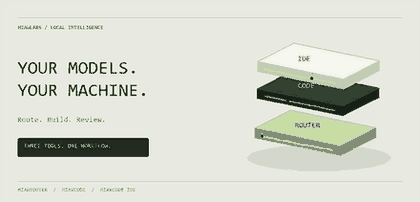
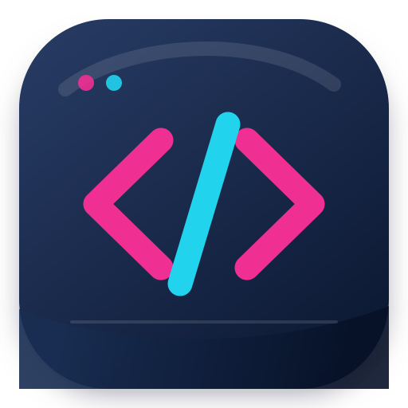
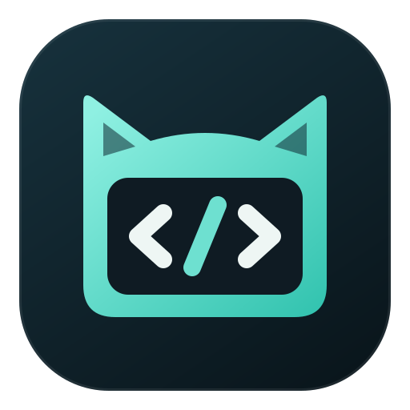

<div align="center">


# MiawLabs

**Your models. Your machine. Your next big thing.**

A local AI developer toolchain. An interactive 3D landing. No navbar. No framework.

[Explore the toolchain](#the-toolchain) · [Run locally](#run-locally) · [Development](#development) · [Deploy](#deploy)




</div>

## The Toolchain

Three tools with different jobs. Use one independently or connect them over a local OpenAI-compatible endpoint.

| | Tool | Role | Availability |
| :---: | --- | --- | --- |
|  | **[MiawRouter](router/index.html)** | Local AI gateway: provider routing, account pools, failover and normalized SSE | npm `miawrouter` |
|  | **[MiawCode](code/index.html)** | Terminal coding agent: anchored edits, commands, checkpoints and extensions | npm `miawcode@0.1.3` |
|  | **[MiawCode IDE](ide/index.html)** | Code - OSS workspace with Agent, Plan and Review | In development; no public installer |

```text
MiawCode / IDE / other clients
              |
              v
    MiawRouter on localhost
    http://127.0.0.1:21128/v1
              |
              v
    Your chosen model providers
    Cloud APIs or local runtimes
```

**Connection detail:** the IDE gateway setting defaults to `21188`. Set it to `21128` when connecting to MiawRouter. A local gateway still sends requests to whichever upstream provider you select; it does not make cloud inference offline.

## The Landing

An editorial, mineral-paper visual system with graphite surfaces and chartreuse signals. Actual motion, not static tilted screenshots.

- **Three.js assembly:** three rounded hardware modules, lighting, shadows, animated entrance, independent floating layers and pulsing LEDs.
- **Direct interaction:** drag to rotate, click modules, select product details, reset the view or pause motion.
- **Product sheets:** layered surfaces, pointer tilt and animated signal traces for Router, Code and IDE.
- **Mode demo:** staggered terminal lines, cursor animation and a moving editor reflection. Examples are illustrative, not a live AI session.
- **Connection diagram:** moving packets and a pulsing local gateway; vertical flow on mobile.
- **Install section:** orbiting brand object, floating command panels and copy buttons where the browser permits clipboard access.
- **Accessible fallbacks:** keyboard-accessible buttons, reduced-motion support, readable content without JavaScript and a CSS preview when WebGL is unavailable.

The README banner is a looping GIF rendered from code. GitHub README pages do not run Three.js, anime.js or interactive JavaScript; open the site for the interactive version.

## Run Locally

### Open directly

Open `index.html` in your browser. The committed classic-script bundle embeds scene textures, allowing the 3D scene to work through `file://` without ES-module import restrictions.

Clipboard access depends on browser security rules. If the Copy button is unavailable, select the command text manually.

### Serve over HTTP

From the repository root:

```powershell
python -m http.server 8765
```

Open **http://localhost:8765**. Stop with `Ctrl+C`.

No install or build is required to view the committed site. All runtime JavaScript dependencies are served locally from this repository.

## Install the Tools

### MiawRouter

```sh
npm install -g miawrouter
miawrouter
```

Default API base: `http://127.0.0.1:21128/v1`.

### MiawCode

```sh
npm install -g miawcode@0.1.3
miawcode
```

Configure provider credentials and review repository trust and permissions before running agent commands.

### MiawCode IDE

In development. This repository does not provide an IDE installer or binary release.

## Three Working Modes

| Mode | Purpose | Boundary |
| --- | --- | --- |
| **Plan** | Investigate files and callers, document assumptions, propose concrete steps and verification | Read-only investigation; produces a plan rather than source edits |
| **Agent** | Execute work, edit files, run checks and report results | Actions follow the configured approval policy |
| **Review** | Report verified issues with severity, file, line, evidence and a fix | Does not modify files |

These are IDE modes. The CLI exposes planning through `/plan` and code review through `/review`; the landing does not execute agent tasks in your browser.

## Repository Map

```text
index.html                    Single-page landing, no navbar
assets/landing.css            Landing layout and section animations
assets/landing.js             Editable Three.js + anime.js source
assets/landing.bundle.js      Committed browser bundle, including scene icons
assets/vendor/                Pinned dependencies and their license notices
assets/miawlabs-icon.svg      Geometric MiawLabs identity
assets/readme-assembly.gif    Animated README banner
assets/style.css              Shared stylesheet for product documentation
router/index.html             Gateway documentation
code/index.html               Terminal agent documentation
ide/index.html                IDE development notes
docs/superpowers/            Historical design plans and specifications
tests/verify-chassis-blade.py  Static content, links and asset checks
tests/verify-landing.cjs       Browser interaction and animation checks
tests/render-readme-banner.py README GIF generator
```

Historical plans describe earlier iterations and are not a specification of the current landing.

## Development

Edit `index.html`, `assets/landing.css` and `assets/landing.js`. Product documentation uses `assets/style.css` independently.

### Rebuild JavaScript

Node.js and npm are required only when rebuilding the bundle:

```sh
npx --yes --package=esbuild@0.25.12 esbuild assets/landing.js --bundle --format=iife --minify --loader:.svg=dataurl --loader:.png=dataurl --outfile=assets/landing.bundle.js --legal-comments=eof
```

Rebuild after changing the JavaScript source or imported scene icons. Commit the generated bundle with its source. Vendor versions: **Three.js 0.186.1** and **anime.js 4.5.0**.

### Static checks

```sh
python tests/verify-chassis-blade.py
node --check assets/landing.js
```

The static verifier also checks canonical MiawCode assets in a sibling `miawcli/miawcode-assets` directory, with the historical `/mnt/Data/miawcli/miawcode-assets` path as a fallback. Without that external asset repository, the cross-repository icon checks report missing sources.

### Browser checks

With Playwright and Chrome already installed:

```sh
node tests/verify-landing.cjs <path-to-installed-playwright>
```

Checks cover WebGL startup, no navbar, responsive widths, product and mode controls, reduced motion, WebGL fallback, direct `file://` loading, changing animation frames and the paused animation clock. The test starts a temporary HTTP server and closes it and the browser automatically.

### Regenerate the README animation

Requires Python and Pillow:

```sh
python tests/render-readme-banner.py
```

The renderer produces 48 looping isometric frames. Pillow is a development-only dependency, not a site runtime dependency.

## Deploy

Publish the repository root to a static host. Keep `index.html`, the product directories and `assets/` together.

### GitHub Pages

1. Push the repository to `main`.
2. Open **Settings > Pages**.
3. Choose **Deploy from a branch**, branch **main**, folder **/ (root)**.
4. Save and wait for GitHub to provide the deployment URL.

A `.nojekyll` file is included. Relative asset paths support deployment under a repository subpath.

### Other Static Hosts

Use the repository root as the publish directory. No deployment-time build command is required because the browser bundle is committed. Never publish local session folders or provider credentials.

## Credits and Rights

Built with [Three.js](https://threejs.org/) and [anime.js](https://animejs.com/). Their MIT license notices are preserved in `assets/vendor/` and the generated bundle.

Copyright &copy; 2026 MiawLabs. All rights reserved for original project content. Third-party dependencies retain their own licenses. This repository currently provides no separate license grant for original code or assets.

## Maintainer

**Sulistyo Fajar Pratama** is the founder and owner of MiawLabs.
GitHub: [skutanjir](https://github.com/skutanjir). npm publisher: [miaws](https://www.npmjs.com/~miaws).
Official identity page: [About MiawLabs](https://miawlabs.web.id/about).
Contact: [project issues](https://github.com/skutanjir/miawlabs/issues). Email addresses are intentionally omitted from public website source and metadata.

### Discoverability checks

Run `python tests/verify-discoverability.py`. See `docs/discoverability-audit.md` for live audit findings, deployment checks and npm metadata follow-up.
